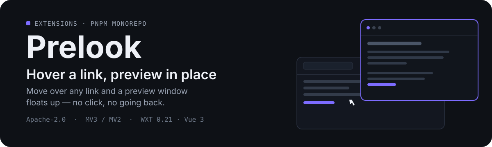
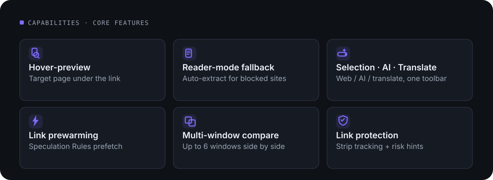

English · [简体中文](README.md)

# What this is

**extensions** is a browser-extension monorepo (pnpm workspace), organized as “two directories per product”: the extension itself plus its landing page.

| Directory | Product |
| --- | --- |
| [`apps/prelook/`](apps/prelook/) | **Prelook** — hover-link preview (Chrome / Edge MV3, Firefox MV2) |
| [`apps/prelook-landing/`](apps/prelook-landing/) | Prelook landing page (zero build, deploy the directory as-is) |
| [`apps/repoways/`](apps/repoways/) | **RepoWays** — a GitHub repo-page extension; zero permissions, content script only |
| [`apps/repoways-landing/`](apps/repoways-landing/) | RepoWays landing page (zero build, deploy the directory as-is) |

Both are completely free: no account, no server, no paid tier. Sponsorship is the only source of revenue.

---

## Prelook — hover a link, preview in place

<p align="center">
  
</p>

“Click, then come back” becomes “see it on hover”: move the cursor over any link and a preview window floats up with the target page.

<p align="center">
  
</p>

- **iframe first**: embeddable pages render directly; sites that block embedding (`X-Frame-Options` / CSP) fall back to reader mode, with the body sanitized through the allow-list in `extract.ts`.
- **Hover-aware**: leaving the cursor gets a 400ms grace before the window auto-closes, and the pin keeps a window open; up to 6 windows at once for comparison.
- **Privacy, locally**: tracking-parameter stripping and phishing-feature hints both run on-device — hints only, never interception.
- **Highly configurable**: four trigger modes, three close triggers, window size and position (including a sidebar dock), 11 color presets plus a custom color and "match the page's own accent", light/dark theme, background blur, power saver and reduced motion; settings live in a side panel.

---

## RepoWays — a second way into any repo

On a GitHub repository page, RepoWays injects a `Ways` button to the **left** of the `Code` button; **clicking** it opens twelve entries. Each URL is built on the fly from the current `owner/repo` in `utils/ways.ts`, and every row is a plain `<a target="_blank">` — no scraping, no API calls, nothing stored.

| Group | Entries |
| --- | --- |
| structure | GitDiagram · Dependency Graph |
| ai | DeepWiki · Zread · GitReverse · GitMCP · Gitingest |
| code | GitHub1s · GitHub.dev · Codespaces · StackBlitz |
| analytics | OSSInsight |

Deliberately different from Prelook: **zero permissions** (`wxt.config.ts` declares none, and AMO's data-collection disclosure is `none`), **no `action`** (the UI is an overlay injected into the page, so nothing is left in the toolbar), and **vanilla TypeScript** (no Vue). The UI lives in a shadow root and reads GitHub's own Primer variables for color.

---

## Quick start

Run from the **repository root** (scripts are forwarded to sub-packages via `pnpm -F`):

```bash
pnpm install                                        # required after a fresh clone / rename
pnpm dev:prelook      / pnpm dev:repoways           # Chrome dev mode (.output/chrome-mv3-dev/)
pnpm build:prelook    / pnpm build:repoways         # production build (compile / zip follow the same pattern, both take :firefox)
pnpm compile          / pnpm build                  # aggregated across all packages
pnpm landing:prelook                                # Prelook landing dev server http://127.0.0.1:4173
pnpm landing:repoways                               # RepoWays landing dev server http://127.0.0.1:8090
pnpm verify:locales                                 # also verify:manifest / verify:landing / lint
```

> Each package's `postinstall` (`wxt prepare`) generates `apps/<name>/.wxt/tsconfig.json`, which `tsconfig.json` `extends` — **compiling before installing fails**.

---

## Tech stack

| Area | Choice | Version |
| --- | --- | --- |
| Package management | pnpm (workspace) | 12 |
| Extension framework | WXT | ^0.21.3 |
| UI | Vue (Prelook only; RepoWays is vanilla TS) | ^3.5.29 |
| Build / dev server | Vite | ^8.1 (landing ^8.3) |
| Language | TypeScript (`vue-tsc` / `tsc --noEmit`) | ^5.9.3 |
| Browser targets | Chrome / Edge (MV3), Firefox (MV2, web-ext) | ^10.5.0 |
| Icons / analytics | `@wxt-dev/auto-icons`, `@wxt-dev/analytics` | ^1.1.2 / ^0.5.6 |
| Quality tools | `oxlint` / `oxfmt`, release-it | ^1.83 / ^0.68 |

The landing pages have **zero runtime dependencies**: Vite is used only as a dev server (`appType: 'mpa'`), and `index.html` / `privacy.html` + `css/` `js/` `assets/` are the deployment artifacts as-is. Prelook's site also ships the agent-facing set (`llms.txt` / `index.md` / `privacy.md` / `robots.txt` / `sitemap*.xml`); RepoWays's currently has only `index.md` / `privacy.md`. **When you change human-facing copy, change the agent-facing copy with it.**

---

## Directory structure

```
apps/
  <name>/                    # the extension; package @extensions/<name>; @/ alias points here
    wxt.config.ts            # the single source of the manifest (permissions/name/description/action)
    entrypoints/             # Prelook: background.ts + content.ts + sidepanel/; RepoWays: content.ts only
    utils/                   # Prelook: storage / preview / selection / extract / i18n / tracking / safety / theme / power…
                             # RepoWays: ways.ts (the twelve entries) + icons.ts (inlined) + menu.css + i18n.ts
    public/_locales/         # en/messages.json + zh_CN/messages.json (default_locale is en)
    assets/logo.webp         # icon source (auto-icons generates all sizes; RepoWays also keeps a logo.svg master)
    test/                    # regression pages: repro-hover.html for Prelook, repro-menu.html for RepoWays
  <name>-landing/            # the landing page; package @extensions/<name>-landing
    index.html privacy.html  css/ js/ assets/  vite.config.js  index.md privacy.md
```

---

## Testing

```bash
pnpm install --frozen-lockfile
pnpm compile && pnpm lint                    # type checks (each product's own way) + oxlint
pnpm verify:locales
pnpm build && pnpm build:firefox             # every app × both targets
pnpm verify:manifest && pnpm verify:landing
```

After touching `content.ts` / `utils/preview/`, run `pnpm build:prelook`, then serve the repo **root** and open `apps/prelook/test/repro-hover.html` — the log should show `windows in shadow: 1`. For RepoWays, build and open `apps/repoways/test/repro-menu.html` the same way (it prints PASS/FAIL per assertion). Note that under headless + `--virtual-time-budget` the browser dispatches no scroll events and does not advance CSS transitions, so scroll-related behavior needs real-time mode.

---

## Sponsorship

Sponsorship is the only revenue for both extensions (there is no paid tier):

- Ko-fi — <https://ko-fi.com/J1R627B7UA>
- Afdian (爱发电) — <https://afdian.com/a/coldstoneboy> (the embedded widget uses `https://afdian.com/leaflet?slug=coldstoneboy`)

Entries live at the bottom of Prelook's settings panel (`SponsorSection.vue`) and in Prelook's landing page (`#sponsor` plus footer); RepoWays's landing page currently carries only an Afdian link in its footer.

---

## License

Licensed under the **Apache License 2.0** ([LICENSE](LICENSE)). See <https://www.apache.org/licenses/LICENSE-2.0>.
