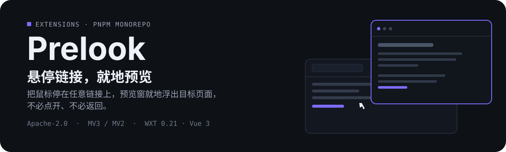
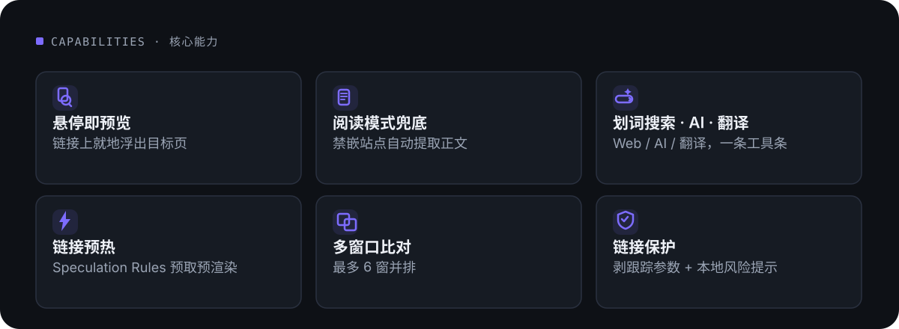

简体中文 · [English](README.en.md)

# 这是什么

**extensions** 是一个浏览器插件 monorepo（pnpm workspace），按「每个产品两个目录」组织：插件本体 + 产品落地页。

| 目录                                               | 产品                                                       |
| -------------------------------------------------- | ---------------------------------------------------------- |
| [`apps/prelook/`](apps/prelook/)                   | **Prelook** — 悬停链接预览（Chrome / Edge MV3、Firefox MV2） |
| [`apps/prelook-landing/`](apps/prelook-landing/)   | Prelook 官网（零构建、整目录部署）                         |
| [`apps/repoways/`](apps/repoways/)                 | **RepoWays** — GitHub 仓库页扩展，零权限纯 content script   |
| [`apps/repoways-landing/`](apps/repoways-landing/) | RepoWays 官网（零构建、整目录部署）                        |

两款都全部功能免费：无账号、无服务器、无付费版本，收入来源只有赞助。

---

## Prelook — 悬停链接，就地预览

<p align="center">
  
</p>

把「先点开、再返回」变成「悬停即见」：鼠标停在任意链接上，预览窗就地浮出目标页面。

<p align="center">
  
</p>

- **iframe 优先**：可内嵌就直接渲染；禁嵌站点（`X-Frame-Options` / CSP）自动切阅读模式，正文走 `extract.ts` 的 `sanitize()` 白名单净化。
- **就地感知**：移开指针有 400ms 宽限再自动关闭，点图钉可固定窗口；最多同时开 6 窗比对。
- **隐私本地化**：跟踪参数剥离与钓鱼特征提示都在本地完成，只提示、不拦截。
- **高度可定制**：四种触发方式、三个关闭触发器、窗口尺寸位置（含侧边栏停靠）、11 套配色预设 + 自定义色 + 跟随页面取色、深浅主题、背景模糊、节电与减少动画，设置面板是侧边栏。

---

## RepoWays — 仓库页上的第二条路

在 GitHub 仓库页的 `Code` 按钮**左边**注入一枚 `Ways` 按钮，**点击**展开十二条入口；URL 由 `utils/ways.ts` 按当前 `owner/repo` 现拼，每条都是普通 `<a target="_blank">`——不抓取、不请求接口、不存储。

| 分组      | 入口                                               |
| --------- | -------------------------------------------------- |
| structure | GitDiagram · Dependency Graph                      |
| ai        | DeepWiki · Zread · GitReverse · GitMCP · Gitingest |
| code      | GitHub1s · GitHub.dev · Codespaces · StackBlitz    |
| analytics | OSSInsight                                         |

与 Prelook 刻意不同：**零权限**（`permissions` 一个都不写，AMO 披露也是 `none`）、**没有 `action`**（UI 是注入页面的浮层，工具栏不留按钮）、**vanilla TypeScript**（不引 Vue）。UI 在 shadow DOM 里，配色直接读 GitHub 自己的 Primer 变量。

---

## 快速开始

在**仓库根目录**执行（脚本经 `pnpm -F` 转发到子包）：

```bash
pnpm install                                        # 首次克隆/目录改名后必跑
pnpm dev:prelook      / pnpm dev:repoways           # Chrome 开发模式，产物在 .output/chrome-mv3-dev/
pnpm build:prelook    / pnpm build:repoways         # 生产构建（compile / zip 同名同规律，均带 :firefox）
pnpm compile          / pnpm build                   # 聚合全部子包
pnpm landing:prelook                                # Prelook 官网 http://127.0.0.1:4173
pnpm landing:repoways                               # RepoWays 官网 http://127.0.0.1:8090
pnpm verify:locales                                 # 另有 verify:manifest / verify:landing / lint
```

> 子包的 `postinstall`（`wxt prepare`）生成 `apps/<name>/.wxt/tsconfig.json`，`tsconfig.json` 正是 `extends` 它——**没 install 就编译会失败**。

---

## 技术栈

| 领域              | 选型                                          | 版本                |
| ----------------- | --------------------------------------------- | ------------------- |
| 包管理            | pnpm（workspace）                             | 12                  |
| 插件框架          | WXT                                           | ^0.21.3             |
| UI                | Vue（仅 Prelook，RepoWays 是 vanilla TS）     | ^3.5.29             |
| 构建 / 开发服务器 | Vite                                          | ^8.1（落地页 ^8.3） |
| 语言              | TypeScript（`vue-tsc` / `tsc --noEmit`）      | ^5.9.3              |
| 浏览器目标        | Chrome / Edge（MV3）、Firefox（MV2，web-ext） | ^10.5.0             |
| 图标 / 分析       | `@wxt-dev/auto-icons`、`@wxt-dev/analytics`   | ^1.1.2 / ^0.5.6     |
| 质量工具          | `oxlint` / `oxfmt`、release-it                | ^1.83 / ^0.68       |

落地页运行期**零依赖**：Vite 只作 dev 服务器（`appType: 'mpa'`），`index.html` / `privacy.html` + `css/` `js/` `assets/` 原样就是部署物；Prelook 官网另带 `llms.txt` / `index.md` / `privacy.md` / `robots.txt` / `sitemap*.xml` 那批 agent 文件，RepoWays 官网目前只有 `index.md` / `privacy.md`。**改面向人的文案要连 agent 那份一起改。**

---

## 目录结构

```
apps/
  <name>/                    # 插件本体，包名 @extensions/<name>；@/ 别名指到这里
    wxt.config.ts            # manifest（权限/名称/描述/action）唯一定义处
    entrypoints/             # Prelook：background.ts + content.ts + sidepanel/；RepoWays：只有 content.ts
    utils/                   # Prelook：storage / preview / selection / extract / i18n / tracking / safety / theme / power…
                             # RepoWays：ways.ts（十二条入口）+ icons.ts（内联图标）+ menu.css + i18n.ts
    public/_locales/         # en/messages.json + zh_CN/messages.json（default_locale 是 en）
    assets/logo.webp         # 图标源图（auto-icons 生成各尺寸；RepoWays 另有母版 logo.svg）
    test/                    # 回归页：prelook 是 repro-hover.html，repoways 是 repro-menu.html
  <name>-landing/            # 落地页，包名 @extensions/<name>-landing
    index.html privacy.html  css/ js/ assets/  vite.config.js  index.md privacy.md
```

---

## 测试

```bash
pnpm install --frozen-lockfile
pnpm compile && pnpm lint                    # 两个产品各自的方式做类型检查 + oxlint
pnpm verify:locales
pnpm build && pnpm build:firefox             # 全部 app × 两个目标
pnpm verify:manifest && pnpm verify:landing
```

改 `content.ts` / `utils/preview/` 后先 `pnpm build:prelook`，再从**仓库根**起静态服务器打开 `apps/prelook/test/repro-hover.html`，确认日志出现 `windows in shadow: 1`；改 RepoWays 的注入同理打开 `apps/repoways/test/repro-menu.html`（逐条打印 PASS/FAIL）。注意无头 + `--virtual-time-budget` 下不派发 scroll 事件、也不推进 CSS 过渡，验证滚动行为要用实时模式。

---

## 赞助

两款扩展的收入来源只有赞助（无付费版本）：

- Ko-fi — <https://ko-fi.com/J1R627B7UA>
- 爱发电 — <https://afdian.com/a/coldstoneboy>（嵌入组件走 `https://afdian.com/leaflet?slug=coldstoneboy`）

入口在 Prelook 设置面板底部（`SponsorSection.vue`）与 Prelook 官网的 `#sponsor` 段 + 页脚；RepoWays 官网目前只有页脚一条爱发电链接。

---

## License

本仓库采用 **Apache License 2.0**（[LICENSE](LICENSE)）。详见 <https://www.apache.org/licenses/LICENSE-2.0>。
